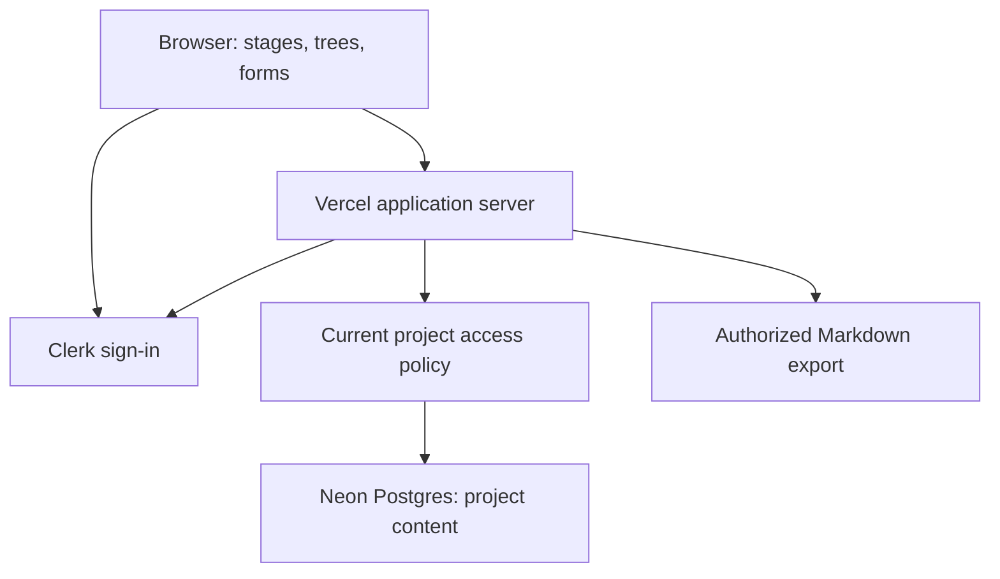

# Architecture direction

**Confirmed:** a simple app on Vercel, Clerk for identity, and Neon Postgres for persistent application data. Nothing is provisioned or implemented. The choices below are proposals unless marked confirmed.

## Proposed implementation shape

Use a single full-stack application, provisionally Next.js with TypeScript. Keep UI, authenticated server operations, policy checks, flow definitions, and persistence in clear modules within one repository. Choose exact versions, ORM, and driver at implementation time after checking current compatibility. Avoid a separate API service until a concrete workload requires it.

Browser code renders guidance and sends edits; the server validates identity, membership, target ownership, inputs, and revisions before accessing Postgres. Never ship database credentials or Clerk secrets to the browser. Save answers and their activity events atomically. Prefer plain structured data for flow templates so the 3D and accessible views share the same content and behavior.

Clerk establishes identity. [Clerk Organizations](https://clerk.com/docs/guides/organizations/overview) supports grouping users with roles and memberships. Two viable project models remain open:

| Option | Advantage | Cost / decision needed |
| --- | --- | --- |
| One Clerk organization per project | Reuse organization membership/invitation capabilities | Validate UX, current pricing/limits, role mapping, and revocation freshness; do not make organization selection an accidental capture barrier. |
| Clerk identity + membership in Postgres | Direct project-specific semantics and one transaction boundary for content/access | Nakama must implement invitations, roles, lifecycle, and their security checks. |

Choose one membership authority before M1. Do not keep two competing membership sources. If using Organizations, application data still needs project-scoped authorization. Do not enable Organizations merely because it is available.

## Data and environments

Postgres stores the [domain model](domain.md), with project-scoped queries, constraints, revision history, and indexes shaped by actual access patterns. Specify deletion/retention before storing historical personal data. No database schema is approved by this document.

[Neon pooling](https://neon.com/docs/connect/connection-pooling) uses PgBouncer and provides pooled connection endpoints. Proposal: pooled application connections, with a separately configured direct connection for migration/admin work that needs session behavior. Select a driver based on the chosen Vercel runtime; do not assume every transport supports the same transaction behavior.

[Vercel environments](https://vercel.com/docs/deployments/environments) distinguish local development, preview, and production. Proposed policy: separate development/preview credentials and isolated test data; preview builds never run against production by accident. Keep migrations as reviewed files and an explicit deployment step, not an unexamined side effect of every build. Test migrations and restore procedures before production changes.

## Security and operational direction

Centralize the [access rules](collaboration.md). Use safe text rendering and validation for user content, including any later Markdown renderer. Log operation IDs, failures, and timings without answer bodies, tokens, or secrets. Add basic error recovery and a visible save status before visual polish. Backups, restore verification, data retention, and service cost limits become launch criteria, not claims of current readiness.

M4 export runs through the same policy and data layer. Later AI gets a scoped context builder and proposals rather than unrestricted database access; [the future AI contract](context-and-ai.md) owns those rules. No provider, vector database, background execution platform, or model choice is committed now.

Official references above were consulted on 2026-10-21. Recheck technical details when implementation begins; they establish platform capabilities, not a working Nakama integration.
