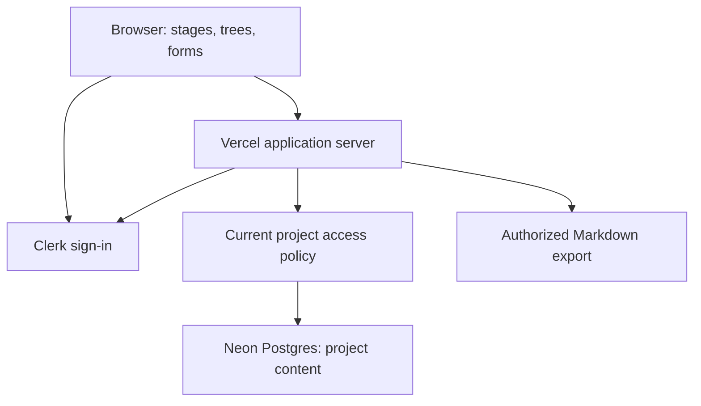

# Architecture direction

**Confirmed:** a simple app on Vercel, Clerk for identity, and Neon Postgres for persistent application data. The first implementation uses Next.js/TypeScript, Clerk identity, and application-owned Postgres memberships. The deployed app and local development currently use the configured Clerk and Neon development resources. The schema/type refinement has been released with migrations 010–012; the development guide records verification. Remaining choices below retain their proposal status.



## Proposed implementation shape

The first slice uses a single full-stack Next.js application with TypeScript. Keep UI, authenticated server operations, policy checks, flow definitions, and persistence in clear modules within one repository. Installed versions are pinned in package-lock.json. The initial persistence layer uses parameterized SQL with node-postgres and an explicit migration runner; it does not add an ORM. Avoid a separate API service until a concrete workload requires it.

Browser code renders guidance and sends edits; the server validates identity, membership, target ownership, inputs, and revisions before accessing Postgres. Never ship database credentials or Clerk secrets to the browser. Save answers and their activity events atomically. Prefer plain structured data for flow templates so the 3D and accessible views share the same content and behavior.

Clerk establishes identity. [Clerk Organizations](https://clerk.com/docs/guides/organizations/overview) supports grouping users with roles and memberships. The implementation chooses Postgres membership for direct transaction-scoped access checks. The considered alternatives were:

| Option | Advantage | Cost / decision needed |
| --- | --- | --- |
| One Clerk organization per project | Reuse organization membership/invitation capabilities | Validate UX, current pricing/limits, role mapping, and revocation freshness; do not make organization selection an accidental capture barrier. |
| Clerk identity + membership in Postgres | Direct project-specific semantics and one transaction boundary for content/access | Nakama must implement invitations, roles, lifecycle, and their security checks. |

Postgres is the membership authority. Clerk Organizations is not enabled. Do not keep two competing membership sources. If using Organizations, application data still needs project-scoped authorization. Do not enable Organizations merely because it is available.

## Data and environments

Postgres stores the [domain model](domain.md), with project-scoped queries, constraints, revision history, and indexes shaped by actual access patterns. Specify deletion/retention before storing historical personal data. The initial schema lives in migrations/001_private_projects.sql; later historical-content policy remains open.

[Neon pooling](https://neon.com/docs/connect/connection-pooling) uses PgBouncer and provides pooled connection endpoints. Proposal: pooled application connections, with a separately configured direct connection for migration/admin work that needs session behavior. Select a driver based on the chosen Vercel runtime; do not assume every transport supports the same transaction behavior.

[Vercel environments](https://vercel.com/docs/deployments/environments) distinguish local development, preview, and production. Proposed policy: separate development/preview credentials and isolated test data; preview builds never run against production by accident. Keep migrations as reviewed files and an explicit deployment step, not an unexamined side effect of every build. Test migrations and restore procedures before production changes.

## Security and operational direction

Centralize the [access rules](collaboration.md). Use safe text rendering and validation for user content, including any later Markdown renderer. Log operation IDs, failures, and timings without answer bodies, tokens, or secrets. Add basic error recovery and a visible save status before visual polish. Backups, restore verification, data retention, and service cost limits become launch criteria, not claims of current readiness.

M4 export runs through the same policy and data layer. Later AI gets a scoped context builder and proposals rather than unrestricted database access; [the future AI contract](context-and-ai.md) owns those rules. No provider, vector database, background execution platform, or model choice is committed now.

Official references above were consulted on 2026-10-21. Recheck technical details when implementation begins; they establish platform capabilities, not a working Nakama integration.

## Application admission — 2026-10-22

Clerk owns the signup email allowlist in addition to identity. The server verifies admission on every private request using verified account emails and the current list; it does not cache admission across requests. This adds an identity-provider request for ordinary members and deliberately fails closed on errors. The configured administrator bypasses the list lookup for admission so list maintenance cannot lock the admin out. Project access remains governed by Postgres memberships, with no application-admin bypass. The same Clerk development instance currently backs development, previews, and the public release, so its signup restriction/list changes apply to all three.

## Access-request storage — 2026-10-22

Use Clerk's existing waitlist-entry Backend API as a small pending request queue, independently of signup mode. Do not switch the instance to Waitlist/Invite-only mode: the current exact-email allowlist remains enabled. All create operations specify `notify: false`; approval adds an allowlist identifier instead of issuing a Clerk invitation. Admin reads use paginated pending entries and omit emails already allowed. Public submissions validate exact emails and have a bounded per-runtime/IP-hash cooldown in addition to provider API limits. The in-memory cooldown is not a distributed quota; no raw IP, password, or authentication token is stored by the request queue. Approval and request cleanup are separate provider calls, ordered to avoid losing unapproved requests.

## Project tasks and Lock-In interchange — 2026-10-22

`task-model.ts` owns browser-safe tree numbering/types; `lockin-format.ts` owns version 1 file validation/conversion; `tasks.ts` owns project-authorized transactional writes, list revisions, import receipts, and export snapshots. Server Actions resolve current app admission before invoking services. Project-row locks serialize task writers and protect consistent reads/exports. A composite parent foreign key prevents cross-project trees. Import validates one selected project, remaps IDs, and inserts its ordered tree in one statement inside the event/receipt transaction. File previews/downloads use the browser; the server does not read the user's local Lock-In store.

## Bounded private artifact storage — 2026-10-23

Migration 008 adds project artifacts and private file bytes in the existing Postgres database, plus artifact activity kinds. This bounded initial implementation provisions no service. There are at most 200 artifacts per project, six images per image artifact, 2 MiB per image (40 million decoded pixels across frames), and 512,000 bytes per Markdown document. Uploads are sequential single-file Server Actions, bounded to 3 MB request bodies; Markdown replacement is atomic. Images are validated with Sharp, using detected format for response MIME and normalizing a mismatched image filename extension.

Library queries return metadata and a cover file ID, never file bytes. Image bytes load through a private, noncached file route that checks current membership and all three nested IDs. Markdown detail reads only its single bounded text payload. The global library uses membership joins and exposes no unrelated project metadata. A future larger-file workload should move blobs behind an equivalent private object-storage gateway; no such service is configured now.

React Markdown with GFM provides headings, lists, task boxes, tables, and code blocks. Raw HTML is skipped, default safe URL handling remains enabled, and external image tags render as links. No MDX, arbitrary HTML, code execution, or syntax-highlighting runtime is enabled. The image lightbox is a viewport-sized native dialog with keyboard close/previous/next and focus restoration.

## Project lineage persistence — 2026-10-23

Migration 009 adds directed `project_links` with a composite primary key, self-link constraint, cascading endpoint references, and reverse lookup index. The lineage service checks membership in both endpoints in a stable order before writes. Graph mutations serialize through transaction advisory lock 734922; a recursive descendant query rejects cycles, including races between opposite edges. Lists join the opposite endpoint's current memberships. Atomic project setup reuses one transaction for project, flow, and source links. Relationship edits do not duplicate endpoint names or IDs into activity, preventing later visibility changes from leaving related project metadata in another project's history.

## Schema and TypeScript contracts — 2026-10-23

SQL migrations own storage shape and the closed domain vocabularies. Migrations 010–012 normalize artifact to-dos into `artifact_tasks`, derive file size from its bytes, introduce shared Postgres enum types, and enforce additional state/revision/reference/graph/output integrity. Artifact tasks retain their stable IDs, explicit order, and the artifact-wide optimistic revision; they remain distinct from hierarchical project tasks. The `(project_id,artifact_id)` foreign key prevents cross-project task attachment. Position uniqueness is deferred so an atomic reorder can temporarily reuse positions. File metadata continues to be read independently of payload bytes. Library cards fetch task/done counts rather than task IDs or titles. Task replacement/reordering uses a batched upsert, keeping database round trips bounded independently of the 100-task limit.

`npm run db:types` constructs an empty, disposable PGlite database from every migration, introspects columns/nullability/enums, and generates `src/shared/contracts/database.generated.ts`. It needs no credentials or hosted connection. Storage models and shared Zod validators reuse those generated types and enum values. `npm run db:check`, also run by typecheck and the test suite, rejects stale generated output. Unknown SQL types fail generation instead of silently becoming `any`. Timestamps use the normal node-postgres `Date` representation; `bigint`/`numeric` retain the driver's default strings. Generated storage rows are not insert/update payload types: defaults and generated columns still belong to SQL and explicit service inputs.

`row-schemas.ts` describes named query projections, checked against storage types with `satisfies`; `queryRows` validates actual driver results before returning domain objects and emits a body-free error on mismatch. All consumed application query results use these decoders, including small internal projections and RETURNING/existence checks. The raw Database interface returns unknown rows and accepts no caller-declared result generic. Parameterized SQL and transaction-scoped membership checks remain in place. This is not a compile-time SQL parser or a new ORM.

The compiler now checks unchecked index access, exact optional properties, consistent returns, switch fallthrough, unused locals, and unused parameters in addition to strict mode. Expected row/template lookups use a checked `required` helper. Task editor states require the selected task for edit/delete/complete operations. Task and artifact action results distinguish successful saves, conflicts, creation, deletion, and failures. Node discussion targets require a stage. Flow registry keys must agree with each flow's ID, and template collections are read-only through their public types.

Intentional historical snapshots remain: membership-time comment/activity author names, answer revisions, and recorded project-capture answers preserve authorship and prior meaning. Project name/description remain the current header projection synchronized by the existing atomic guidance service. This refinement does not replace history with joins to mutable current records or introduce a second identity authority.

Database triggers protect direct/future writers as well as the application: project/task ancestry is acyclic, artifact kind is immutable, and final artifact output must match its kind, readiness, and file limits. Deferred output checks permit atomic Markdown replacement and changing readiness with file operations. Per-artifact file locks prevent concurrent uploads from exceeding cardinality limits. Binary image validity and template-specific question/stage membership still require the application validators; SQL constraints do not parse image formats or duplicate the source-controlled guidance templates.

The existing membership/project selectors and global library still need cursor pagination for large numbers of projects; this refinement preserves their current complete-list behavior. Per-project task/artifact limits and smaller card projections reduce payloads but do not establish a measured production capacity limit.

## Database read contracts — 2026-10-23

The raw Database/Queryable interface returns unknown rows. Application code uses queryRows with an explicit runtime schema for every consumed SELECT or RETURNING projection, including existence checks, invitation acceptance, revision checks, notification pagination, and stored file bytes. SQL used only to acquire locks or execute writes can ignore its result. Query result types are inferred from decoders; schemas reuse generated storage enums and validate their projected shapes against DatabaseRows. Decoder failures expose a fixed message without row contents, and transactional operations roll back.

## Operational logging — 2026-10-23

Backend observability is separate from project Activity. Versioned, schema-validated JSON events describe static operation names, normalized route templates, durations, outcomes, database counts/query fingerprints, transaction commit/rollback, connection wait/pool counts, and safe error classifications. AsyncLocalStorage links nested work through server-generated request/trace and span IDs. Proxy replaces incoming trace/route headers and returns x-nakama-request-id; identities and resource IDs are not used as diagnostic context. All Server Actions, authorization, identity-provider adapters, and private file responses are observed. Next instrumentation captures startup and uncaught request errors. This is application tracing, not a full HTTP/OpenTelemetry collector.

Raw error messages, Postgres DETAIL, SQL text/parameters, request headers/bodies, tokens, URLs/query strings, names, email addresses, project content, file bytes, and conflict snapshots are excluded. Errors retain a safe category/type, SQLSTATE or approved transport code, opaque error ID, and bounded relative code locations. Fingerprints group repeat failures; the same error ID links database, transaction, and action events. Unexpected errors crossing observed database/action/provider seams are replaced with safe BackendError instances before propagation, without copying cause or private properties. Expected ProjectError/conflict feedback and Next redirect/not-found control flow retain their behavior.

Structured stdout/stderr is the production transport. Outside Vercel, a private local JSONL copy is enabled by default at .nakama/logs/backend.jsonl. Files rotate at 5 MiB with three archives (roughly 20 MiB per destination); directories created by the writer are 0700 and files are 0600. Writers reject symlink/hardlink destinations and coordinate rotation with a short-lived lock. Contention, filesystem failure, or logging-sink failure never changes application results; stdout remains the fallback, with a bounded sink warning. Local files are best-effort diagnostics, not a lossless audit or recovery journal. Vercel filesystem persistence is disabled. Operational files are ignored by Git and explicitly excluded from deployment traces.

The default info level retains action/identity outcomes, all unexpected failures, write-transaction commits, queries/connection waits at least 250ms, and transactions/operations at least 1000ms. Commit-acknowledgment failures are explicitly commit_unknown; failed rollbacks are rollback_failed, rather than asserting a successful rollback. Debug additionally retains normal query/transaction events and quiet authorization/notification completions. Operation query totals include successful fast queries even when their individual records are omitted. Error summaries deduplicate nested reports by error ID and overlapping imported records by record identity. Logs remain metadata about private operations and should be treated as private operational material.

Read-only local commands summarize operations/errors/slow queries, inspect a trace or query fingerprint, and filter by time window. A bounded Vercel CLI importer retains only validated Nakama records, never raw platform envelopes, provider stderr, arbitrary messages, or credentials. Existing CLI authentication/project access applies; no hosted service, monitoring account, scheduled collection, or public log endpoint is introduced.


## Typed diagnostic evidence — 2026-10-23

The operational log envelope now carries a shared diagnostic union for compiler, build, contract, application, database, dependency and compute families. Runtime schemas own TypeScript inference; the exhaustive diagnostic catalog makes a new code require explicit severity, investigation and retry guidance. This family is independent of expectedness, operation outcome and transaction certainty. All new classified runtime errors carry a diagnostic; additive optional fields preserve the ability to read older archives.

The compiler worker collects safe TypeScript codes/locations, the build supervisor records check and process outcomes, Clerk adapters classify failures and decode consumed projections, and hosting import reduces supported system events into allowlisted evidence. A provider response body, compiler message, platform log message, credential or source excerpt is never the diagnostic payload. Unknown causes remain unknown. SQLSTATE and transaction outcome must be considered together before any proposed repair.

A per-build identity and server-only source maps support offline source-location recovery against the matching build. Logs and maps do not establish release deployment: remote CI/hosting collection and production request behavior need separate verification. No new service, automatic repair, release or migration was introduced. See the [diagnostic workflow](development.md#typed-diagnostic-catalog--2026-10-23).

## Feature ownership and frontend composition — 2026-10-23

```text
src/
  app/                     Next routes, layouts, loading/error UI, metadata, HTTP adapters
  features/
    access/                admission, administrator controls, identity adapters
    artifacts/             outputs, uploads, readers, artifact tasks
    collaboration/         comments, invitations, membership UI, activity
    guidance/              full templates, generated picker catalog, answers/reviews/map
    notifications/         unread comment reads and notification interaction
    preferences/           locale/density controls and cookie actions
    projects/              capture/setup, cards, workspace composition, lineage
    shell/                 header/footer composition
    tasks/                 hierarchical tasks and Lock-In exchange
  shared/
    contracts/             generated storage types, closed vocabularies, common identities/results
    i18n/                  translation functions, selected dictionary provider, server locale adapter
    lib/                   genuinely shared pure helpers
    ui/                    internal component library and colocated stories
  server/
    database/              pool, transactions, query decoding/projections, activity insert primitive
    observability/         safe diagnostics, collectors, correlation, local files and offline readers
```

A feature owns its model, input validation, Server Actions, service implementation, components, and prefixed stylesheet. Models may be a `model.ts` or an organized `model/` directory for the larger guidance definitions. Use explicit import paths; do not introduce mixed environment barrels. Routes assemble features and call authorized services; features never import `app`. Shared code and infrastructure never import features. The shared Actor contract prevents database instrumentation from depending on the project implementation.

The runtime feature dependency policy is explicit in [the architecture checker](../scripts/check-architecture.ts). Projects, guidance and collaboration coordinate through named service functions; a feature-level dependency in both directions is allowed only where the module graph remains acyclic. Shell composes preferences, project navigation, notifications and access. Tasks and artifacts depend on project authorization. Add a new feature/dependency to that policy deliberately rather than bypassing the rule through a general utilities directory.

The checker rejects runtime import cycles, undeclared feature dependencies, infrastructure-to-feature imports, app imports from lower layers, primitive bypasses, and transitive browser paths to server code or full workflow templates. Client code may import explicit `use server` action modules, which Next turns into RPC references. Presentation contracts come from feature models rather than server implementations. Type-only references do not create runtime graph edges. Next's own compiler remains a second check; the custom guard is not a full JavaScript security analyzer.

Reusable UI has no project, identity, database, router or Server Action dependency. React 19 native props and refs preserve form semantics. Shared dialogs and tabs concentrate keyboard behavior; inactive tab panels remain mounted to retain drafts. [Component library](component-library.md) owns the API and Storybook workflow.

Prefer server composition and small interactive components. The language provider receives only the selected locale dictionary, so English pages do not import the complete Spanish dictionary through a shared hook. The type picker uses a generated summary catalog; full templates remain server-owned. Markdown and question/review editors load conditionally, and the 3D module remains conditional on opening its dialog. No shared caching of private project reads is introduced.

The app's global stylesheet is now an ordered import entrypoint: library tokens/foundations, then feature-owned styles. Keep feature selectors domain-prefixed; use the shared controls and tokens instead of duplicating their appearance. Shared global patterns intentionally apply in Storybook too.

See [engineering preferences](engineering-preferences.md), [contribution steps](../CONTRIBUTING.md), and [frontend measurements](frontend-performance.md). Architecture and documentation changes do not establish deployed or production performance by themselves.
