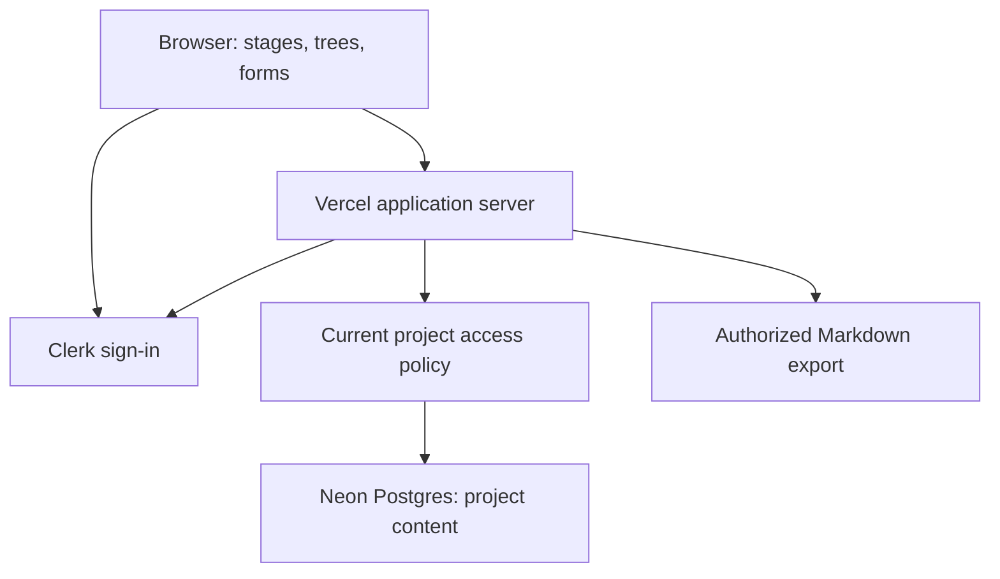

# Architecture direction

**Confirmed:** a simple app on Vercel, Clerk for identity, and Neon Postgres for persistent application data. The first implementation uses Next.js/TypeScript, Clerk identity, and application-owned Postgres memberships. Dedicated Clerk and Neon development resources are now connected locally; no production deployment exists. Remaining choices below retain their proposal status.

## Proposed implementation shape

The first slice uses a single full-stack Next.js application with TypeScript. Keep UI, authenticated server operations, policy checks, flow definitions, and persistence in clear modules within one repository. Installed versions are pinned in package-lock.json. The initial persistence layer uses parameterized SQL with node-postgres and an explicit migration runner; it does not add an ORM. Avoid a separate API service until a concrete workload requires it.

Browser code renders guidance and sends edits; the server validates identity, membership, target ownership, inputs, and revisions before accessing Postgres. Never ship database credentials or Clerk secrets to the browser. Save answers and their activity events atomically. Prefer plain structured data for flow templates so the 3D and accessible views share the same content and behavior.

Clerk establishes identity. [Clerk Organizations](https://clerk.com/docs/guides/organizations/overview) supports grouping users with roles and memberships. The implementation chooses Postgres membership for direct transaction-scoped access checks. The considered alternatives were:

| Option | Advantage | Cost / decision needed |
| --- | --- | --- |
| One Clerk organization per project | Reuse organization membership/invitation capabilities | Validate UX, current pricing/limits, role mapping, and revocation freshness; do not make organization selection an accidental capture barrier. |
| Clerk identity + membership in Postgres | Direct project-specific semantics and one transaction boundary for content/access | Nakama must implement invitations, roles, lifecycle, and their security checks. |

Postgres is the membership authority. Clerk Organizations is not enabled. Do not keep two competing membership sources. If using Organizations, application data still needs project-scoped authorization. Do not enable Organizations merely because it is available.

## Data and environments

Postgres stores the [domain model](domain.md), with project-scoped queries, constraints, revision history, and indexes shaped by actual access patterns. Specify deletion/retention before storing historical personal data. The initial schema lives in migrations/001_private_projects.sql; later historical-content policy remains open.

[Neon pooling](https://neon.com/docs/connect/connection-pooling) uses PgBouncer and provides pooled connection endpoints. Proposal: pooled application connections, with a separately configured direct connection for migration/admin work that needs session behavior. Select a driver based on the chosen Vercel runtime; do not assume every transport supports the same transaction behavior.

[Vercel environments](https://vercel.com/docs/deployments/environments) distinguish local development, preview, and production. Proposed policy: separate development/preview credentials and isolated test data; preview builds never run against production by accident. Keep migrations as reviewed files and an explicit deployment step, not an unexamined side effect of every build. Test migrations and restore procedures before production changes.

## Security and operational direction

Centralize the [access rules](collaboration.md). Use safe text rendering and validation for user content, including any later Markdown renderer. Log operation IDs, failures, and timings without answer bodies, tokens, or secrets. Add basic error recovery and a visible save status before visual polish. Backups, restore verification, data retention, and service cost limits become launch criteria, not claims of current readiness.

M4 export runs through the same policy and data layer. Later AI gets a scoped context builder and proposals rather than unrestricted database access; [the future AI contract](context-and-ai.md) owns those rules. No provider, vector database, background execution platform, or model choice is committed now.

Official references above were consulted on 2026-10-21. Recheck technical details when implementation begins; they establish platform capabilities, not a working Nakama integration.

## Application admission — 2026-10-22

Clerk owns the signup email allowlist in addition to identity. The server verifies admission on every private request using verified account emails and the current list; it does not cache admission across requests. This adds an identity-provider request for ordinary members and deliberately fails closed on errors. The configured administrator bypasses the list lookup for admission so list maintenance cannot lock the admin out. Project access remains governed by Postgres memberships, with no application-admin bypass. The same Clerk development instance currently backs development, previews, and the public release, so its signup restriction/list changes apply to all three.

## Access-request storage — 2026-10-22

Use Clerk's existing waitlist-entry Backend API as a small pending request queue, independently of signup mode. Do not switch the instance to Waitlist/Invite-only mode: the current exact-email allowlist remains enabled. All create operations specify `notify: false`; approval adds an allowlist identifier instead of issuing a Clerk invitation. Admin reads use paginated pending entries and omit emails already allowed. Public submissions validate exact emails and have a bounded per-runtime/IP-hash cooldown in addition to provider API limits. The in-memory cooldown is not a distributed quota; no raw IP, password, or authentication token is stored by the request queue. Approval and request cleanup are separate provider calls, ordered to avoid losing unapproved requests.

## Project tasks and Lock-In interchange — 2026-10-22

`task-model.ts` owns browser-safe tree numbering/types; `lockin-format.ts` owns version 1 file validation/conversion; `tasks.ts` owns project-authorized transactional writes, list revisions, import receipts, and export snapshots. Server Actions resolve current app admission before invoking services. Project-row locks serialize task writers and protect consistent reads/exports. A composite parent foreign key prevents cross-project trees. Import validates one selected project, remaps IDs, and inserts its ordered tree in one statement inside the event/receipt transaction. File previews/downloads use the browser; the server does not read the user's local Lock-In store.
