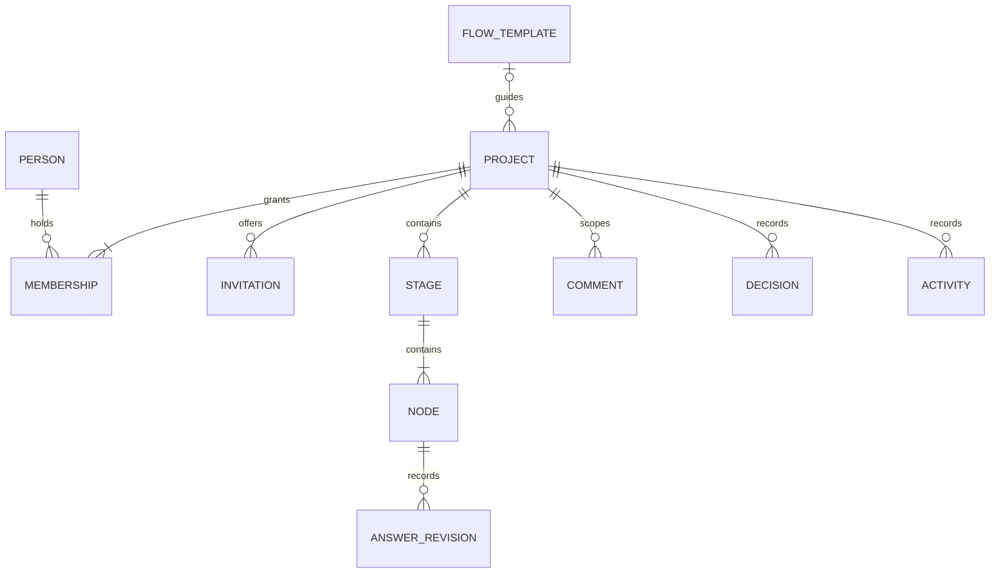

# Domain vocabulary and conceptual model

This logical model guides the implementation. M1/M2 tables live in reviewed SQL migrations; comments/activity are implemented; remaining lifecycle policy is still planned. [Flows](flows.md) own stage names; [collaboration](collaboration.md) owns access policy.

| Term | Meaning |
| --- | --- |
| Person | A Clerk identity; profile display data is not an authorization rule. |
| Project | An idea, purpose, flow, answers, discussions, decisions, and members. The access boundary. |
| Membership | A person's role and active/removed access to one project. |
| Invitation | A time-limited offer, separate from membership until accepted. |
| Flow template | Versioned project guidance; projects retain their chosen version. |
| Stage | Named flow section containing a question subdiagram and discussion. |
| Node | Stable, addressable question, activity, or outcome; not every diagram box needs a text field. |
| Answer revision | Content with author, timestamp, revision ID, and optional evidence. |
| Learning | Observation, including an unfavorable result or uncertainty. |
| Decision | Explicit choice with rationale and author/time, not inferred from completion count. |
| Comment | Discussion targeting exactly one project, stage, node, or project activity scope; not automatically an answer. |
| Activity | Attributable edit, decision, membership change, or future proposal review. |
| Task | Small planned action; detailed scheduling is deferred. |
| Artifact | A named project output in progress or ready, optionally associated with a stage; image set, Markdown document, or linked software. |

This summarizes ownership, not every foreign key. Comments additionally target one scope within their project. Decisions can reference stages/nodes and evidence. Stage/node instances retain stable IDs and template keys so exports/history survive label changes. A newly captured project may have no flow/stages; choosing a flow instantiates its stages.

## State and progress (implemented in the guided-flow slice)

- Node: `unanswered`, `draft`, `answered`, `skipped`, or `blocked`. An answer can explicitly record an unknown; empty text alone is not answered. Skips have reasons; blocked nodes retain drafts and explain blockers.
- Stage: `not_started`, `in_progress`, or `reviewed`. A human marks reviewed after considering the outcome. Reopening preserves history.
- Project: `active`, `parked`, or `finished_enough`. Decisions record changes and rationale; resuming preserves work.

Show “answered X of Y question nodes” with separate skipped/blocked counts. Activity/outcome nodes are excluded from the denominator. Percentage is not validity or viability. A negative finding can be answered; parking can be a reviewed outcome.

Recommend a next node without locking earlier content or forcing every answer. A stage may be reviewed with unresolved questions if the person records them and explains the decision. Changed upstream answers flag dependent conclusions for review rather than deleting them. Dependency edges guide work; they do not grant access.

## Integrity rules

Every nested record must resolve to the same project; validate server-side and use database constraints where possible. Membership is unique per person/project. Under the proposed policy a project always retains an active owner. Answer edits check revisions to prevent silent overwrite. Store UTC timestamps; display local time.

Template updates never silently rewrite existing projects. Flow/version migration needs a preview of retained/unmapped answers; defer it in the first version. Whole-project deletion follows the owner-confirmed permanent removal policy in [collaboration](collaboration.md). Account retention/deletion and ownership succession remain deferred.

## Comment and activity records — 2026-10-22

Comments belong to one project and one scope: project, stage, node, project tasks, or project artifacts. Stage/node targets require the selected project flow; the server validates stable template keys. Authors retain their membership-time display attribution when they leave. Revisions prevent silent overwrites. Deleted bodies are blanked permanently while the comment ID, original author/time, and deletion marker remain. Discussion does not count toward answered progress or invalidate answer reviews.

Activity describes attributable recorded actions. Current comment bodies are not duplicated into activity. Existing answer revisions and stage reviews provide historical source events; new project, flow, invitation, membership, and comment events are stored in a project-owned activity table. Former-member labels do not re-grant access. Whole-project deletion cascades through both stores.

## Outcomes and related projects — accepted direction, 2026-10-22

A project can produce one or more outcomes, such as a conclusion, actionable next steps, or an artifact. An outcome may motivate several follow-up projects; projects may be related to each other. These are distinct from answer counts or a stage-review flag. The first Investigation implementation records an output choice and developed result as ordinary answers. Artifacts now have dedicated project-scoped records; universal outcome records remain future work. Directed project relationships and spawning are implemented locally. Related projects retain independent membership boundaries, including when listing or following relationships.

## Project tasks — 2026-10-22

A Task is a project-scoped unit of work with a stable ID, title, Ready/In progress/Done status, optional parent task, saved collapsed state, attribution, and timestamps. It is independent of guided-flow nodes and question progress. Display numbers such as 1.2.1 are derived from sibling insertion order and change after deletion. Completing a parent never infers child completion: explicitly choose only the parent or its entire subtree. Reopening a task does not change its children. Deleting a task removes its subtree after confirmation. All task mutations compare the project task-list revision; conflicts retain the draft and require review before retrying.

Lock-In imports append a selected source tree into one authorized Nakama project, assigning new stable IDs and retaining task metadata. An import receipt prevents re-importing the exact same normalized source project. Export produces a version 1 Lock-In state with only the current project, no application memberships, guided answers, or comments. Cross-project relationships and spawning are separate from task import/export.

## Project artifacts — 2026-10-23

An Artifact belongs to exactly one project and optionally one of its selected flow's stages. It is an output, distinct from an answered node, stage review, project state, or conclusion. Image/design artifacts contain up to six uploaded images; Markdown artifacts contain one replaceable uploaded document; software artifacts reference an HTTPS GitHub repository/release/source URL. Artifact type is fixed at creation. An artifact's stable private URL links back to its project and stage.

Artifacts begin In progress and may exist before their output. Ready (shown as Ready to use / Listo para usar) is an explicit state requiring at least one correctly typed image, a Markdown file, or a GitHub link. An artifact's own shared to-do list holds up to 100 flat, individually named Ready/In progress/Done tasks. Tasks do not automatically set artifact readiness, guided progress, or project state; these tasks are separate from the project's hierarchical To-do list and its Lock-In file interchange.

One artifact revision protects metadata, to-dos, uploads, file removal, and deletion. A stale writer receives the latest authorized snapshot and retains drafts for explicit reconciliation. Replacing Markdown removes the earlier file after validation in the same transaction; this slice does not retain artifact version history. Removing an image artifact's last ready output requires first returning it to In progress. Deleting an artifact removes its files/to-dos; project deletion cascades through artifacts too.

## Project lineage — 2026-10-23

A directed project link records a source project and a spawned project. Either endpoint can have several links: several projects can contribute to one new project, and one project can spawn several follow-ups. Self-links and circular ancestry are rejected. Repeated links are idempotent. Links describe origin, not task dependencies or shared ownership.

Spawning atomically creates the new project, creator's owner membership, optional selected flow, and selected source links. No memberships, answers, comments, tasks, artifacts, or files are copied. Links can also connect existing projects or be removed without deleting either endpoint. Deleting a project cascades only its incident links; linked projects survive.

## Persistence normalization and types — 2026-10-23

Artifact to-dos are now individual rows keyed by project, artifact, and task ID, with explicit position and the shared Task status vocabulary. Their update/reorder still compares and increments the artifact revision in one transaction. File size is computed from the stored payload. Node status, Task status, Artifact kind/readiness/media type, Membership role, Project state, Flow ID, activity kind, and answer origin have database enum types shared with generated TypeScript and input validators.

Current answers and historical revisions enforce the same content/state rules. Activity's optional comment reference resolves to the same project. Project/task ancestry and artifact output invariants are also guarded by the database. Storage types describe actual nullability and driver values; UI projections and untrusted operation inputs are separate contracts.

## Product glossary and naming contract — 2026-10-24

The application’s public `/wiki/glossary` page (also available at `/glossary`) exposes system definitions only, never project records. Its bilingual presentation catalog lives in `src/features/shell/glossary.ts`; this document remains canonical for domain semantics. Update both when changing a definition. The glossary groups terms by projects/access, guidance/progress, learning/decisions, work/outputs, discussion/change history, and project relationships; these are reading groups, not new domain entities. Database-backed state lists on the page reuse generated enum constants rather than duplicating their values.

Use **Flow** for selected guidance, **Stage** for its sections, **Node** for addressable questions/activities/outcomes, and **Answer** for saved node content. Use **Project flow** for the guidance workspace and **Save answer** for answer submission. “Workflow,” “journey,” and “step” are synonyms or legacy presentation identifiers, not additional entities. New domain code should use `flow`, `stage`, `node`, and `answer`; existing component names, URL parameters, database enums, and interchange fields remain compatible.

Use **Task** for work, qualified as **Project task** (hierarchical) or **Artifact task** (flat) when ambiguous. “To-do” names the task workspace, not another entity. **Artifact readiness** and **Task status** are independent: a ready task is available to start; a ready artifact has usable output. **Discussion** names the conversation; **Comment** names one message. **Activity** names an attributable event, qualified as an activity node or operational log when referring to those different concepts.

**Learning**, **Decision**, and **Outcome** describe domain concepts; they do not imply universal dedicated storage or editors. Outcomes currently use answers and artifacts. Guided-context export remains future work. **Project lineage** records source/spawned relationships and never implies inherited membership or copied content.

## Experiment lab — 2026-10-26

An **Experiment** belongs to one project, independently of its selected flow. Its short plan records a claim, method and success criteria. Optional scope, metric/unit, baseline, responsible person, action/budget limits, milestone label and one related question add detail progressively. A milestone is currently a label, not a task container or scheduler. Creative experiments need no commercial criteria.

**Plan versions** are retained. Starting a **Run** freezes the selected plan and related question's answer revision/content. Repeating creates another run. Execution is running, completed or cancelled; completion never means that the claim is supported. Human effort in minutes and actual cost/currency are optional; missing means unknown, including when the actual value is zero. Deviations remain attached to that execution. Completed/cancelled execution records cannot be rewritten through the service.

**Evidence** is append-only retained text with source attribution, kind (AI analysis, external evidence, measurement or observation), optional measured value/unit, actor and timestamp. Sources can name URLs or existing artifacts, but the referenced file/page is not fetched, versioned or guaranteed available. Include the observation, excerpt or data in the retained content. Corrections are additional records. Structured numeric comparisons and generic binary evidence uploads are deferred.

A **Review** belongs to a completed run and preserves its plan, execution and evidence snapshot. Claim assessment (supported, contradicted, inconclusive) and next action (continue, revise, stop) are separate. A rationale records scope and uncertainty. AI analysis alone cannot yield supported/contradicted empirical claims. Changed question input or a newer plan flags context changes and requires reconciliation. Subsequent evidence does not rewrite earlier reviews; the UI identifies newer material. New reviews preserve prior ones. No business-wide validation badge or inferred viability score exists.

**Agent contributions** are manually submitted proposals attached to a run, retaining original content, claimed agent attribution, sources and submitting member. A human accepts, edits or rejects with a review note, including changed-context reconciliation. Accepted content becomes attributed AI analysis; it does not change questionnaire answers or record a claim assessment. This is manual provenance, not authenticated proof of agent identity.

Project task hierarchy/status/Lock-In, artifacts/readiness, stage reviews, discussions and lineage remain independent. Whole-project deletion cascades through lab records. Individual experiment deletion is not exposed in this slice.

### Universal experiment cycle — 2026-10-26

Every project is a place to develop and test ideas, regardless of its selected flow. The common learning cycle is **Idea → Test plan → Run → Evidence → Review → Next decision**, repeated as needed. Flow-specific questions frame the uncertainty; they do not establish truth. Completion of an answer, task, artifact, stage, or run never implies that the idea is validated.

A project description or selected question answer can be copied into an editable, unsaved experiment claim. The user must supply a method and criterion before saving; no method, threshold, baseline or result is invented. A question-derived experiment retains its question link, and runs snapshot that question as before. Unselected-flow projects can also start an experiment. This cycle is shared navigation, not an inferred progress meter or a new lifecycle enum.

Inputs retain their meaning: ideas and answers are candidate claims/context; tasks describe work; artifacts and observations can supply evidence when explicitly attributed to a run. Discussion and agent interpretation do not become empirical evidence merely by being saved. Results remain bounded to the retained plan, run and evidence snapshot. Assessment and the next action remain separate. Creative projects test user-chosen experiences or intentions without requiring market validation.
