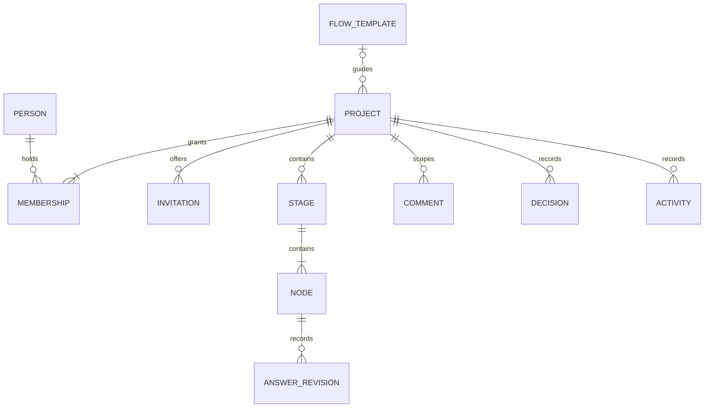

# Domain vocabulary and conceptual model

This logical model guides the implementation. M1/M2 tables live in reviewed SQL migrations; comments/activity are implemented; remaining lifecycle policy is still planned. [Flows](flows.md) own stage names; [collaboration](collaboration.md) owns access policy.

| Term | Meaning |
| --- | --- |
| Person | A Clerk identity; profile display data is not an authorization rule. |
| Project | An idea, purpose, flow, answers, discussions, decisions, and members. The access boundary. |
| Membership | A person's role and active/removed access to one project. |
| Invitation | A time-limited offer, separate from membership until accepted. |
| Flow template | Versioned Venture or Creative/fun guidance; projects retain their chosen version. |
| Stage | Named flow section containing a question subdiagram and discussion. |
| Node | Stable, addressable question, activity, or outcome; not every diagram box needs a text field. |
| Answer revision | Content with author, timestamp, revision ID, and optional evidence. |
| Learning | Observation, including an unfavorable result or uncertainty. |
| Decision | Explicit choice with rationale and author/time, not inferred from completion count. |
| Comment | Discussion targeting exactly one project, stage, or node; not automatically an answer. |
| Activity | Attributable edit, decision, membership change, or future proposal review. |
| Task | Small planned action; detailed scheduling is deferred. |

This summarizes ownership, not every foreign key. Comments additionally target one scope within their project. Decisions can reference stages/nodes and evidence. Stage/node instances retain stable IDs and template keys so exports/history survive label changes. A newly captured project may have no flow/stages; choosing a flow instantiates its stages.

## State and progress (implemented in the guided-flow slice)

- Node: `unanswered`, `draft`, `answered`, `skipped`, or `blocked`. An answer can explicitly record an unknown; empty text alone is not answered. Skips have reasons; blocked nodes retain drafts and explain blockers.
- Stage: `not_started`, `in_progress`, or `reviewed`. A human marks reviewed after considering the outcome. Reopening preserves history.
- Project: `active`, `parked`, or `finished_enough`. Decisions record changes and rationale; resuming preserves work.

Show “answered X of Y question nodes” with separate skipped/blocked counts. Activity/outcome nodes are excluded from the denominator. Percentage is not validity or viability. A negative finding can be answered; parking can be a reviewed outcome.

Recommend a next node without locking earlier content or forcing every answer. A stage may be reviewed with unresolved questions if the person records them and explains the decision. Changed upstream answers flag dependent conclusions for review rather than deleting them. Dependency edges guide work; they do not grant access.

## Integrity rules

Every nested record must resolve to the same project; validate server-side and use database constraints where possible. Membership is unique per person/project. Under the proposed policy a project always retains an active owner. Answer edits check revisions to prevent silent overwrite. Store UTC timestamps; display local time.

Template updates never silently rewrite existing projects. Flow/version migration needs a preview of retained/unmapped answers; defer it in the first version. Whole-project deletion follows the owner-confirmed permanent removal policy in [collaboration](collaboration.md). Account retention/deletion and ownership succession remain deferred.

## Comment and activity records — 2026-10-22

Comments belong to one project and one scope: project, stage, or node. Stage/node targets require the selected project flow; the server validates stable template keys. Authors retain their membership-time display attribution when they leave. Revisions prevent silent overwrites. Deleted bodies are blanked permanently while the comment ID, original author/time, and deletion marker remain. Discussion does not count toward answered progress or invalidate answer reviews.

Activity describes attributable recorded actions. Current comment bodies are not duplicated into activity. Existing answer revisions and stage reviews provide historical source events; new project, flow, invitation, membership, and comment events are stored in a project-owned activity table. Former-member labels do not re-grant access. Whole-project deletion cascades through both stores.

## Outcomes and related projects — accepted direction, 2026-10-22

A project can produce one or more outcomes, such as a conclusion, actionable next steps, or an artifact. An outcome may motivate several follow-up projects; projects may be related to each other. These are distinct from answer counts or a stage-review flag. The first Investigation implementation records an output choice and developed result as ordinary answers. Universal outcome records, cross-project relationships, and spawning remain future work. Related projects retain independent membership boundaries, including when listing or following relationships.

## Project tasks — 2026-10-22

A Task is a project-scoped unit of work with a stable ID, title, Ready/In progress/Done status, optional parent task, saved collapsed state, attribution, and timestamps. It is independent of guided-flow nodes and question progress. Display numbers such as 1.2.1 are derived from sibling insertion order and change after deletion. Completing a parent never infers child completion: explicitly choose only the parent or its entire subtree. Reopening a task does not change its children. Deleting a task removes its subtree after confirmation. All task mutations compare the project task-list revision; conflicts retain the draft and require review before retrying.

Lock-In imports append a selected source tree into one authorized Nakama project, assigning new stable IDs and retaining task metadata. An import receipt prevents re-importing the exact same normalized source project. Export produces a version 1 Lock-In state with only the current project, no application memberships, guided answers, or comments. Cross-project relationships and spawning are separate future work.
