# Guided flows

The stage names, questions, and paths below are accepted product direction. Prompt examples are illustrative copy proposals. Arrows guide exploration, not mandatory gates. Revisit any stage; preserve answers and learning. Branches converge into a discussion or decision, not an automated score. [Domain](domain.md) defines progress; [interaction](interaction.md) defines navigation.

## Venture overview

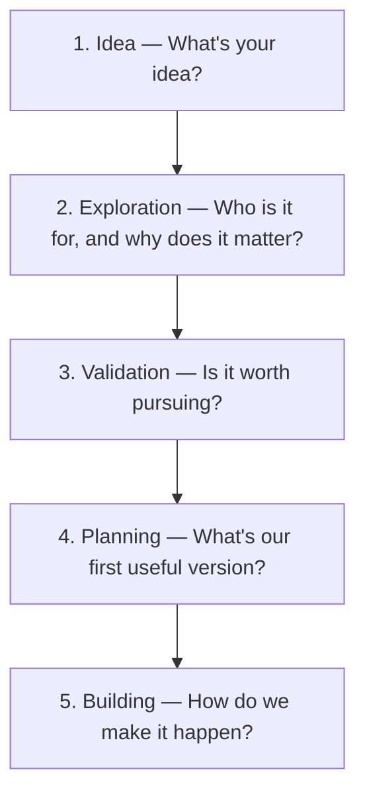

### 1. Idea — What's your idea?

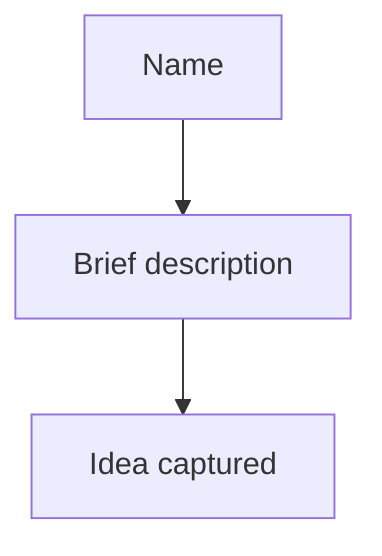

Example: “A neighborhood tool library. Let neighbors borrow rarely used tools.” Save before requesting deeper answers.

### 2. Exploration — Who is it for, and why does it matter?

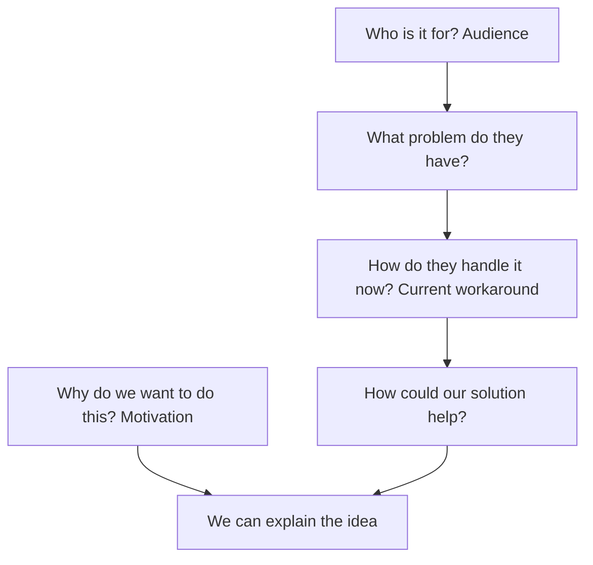

Example: “Apartment dwellers buy a drill for one job. Could borrowing one nearby be easier?” Motivation may be personal, financial, social, or mixed.

### 3. Validation — Is it worth pursuing?

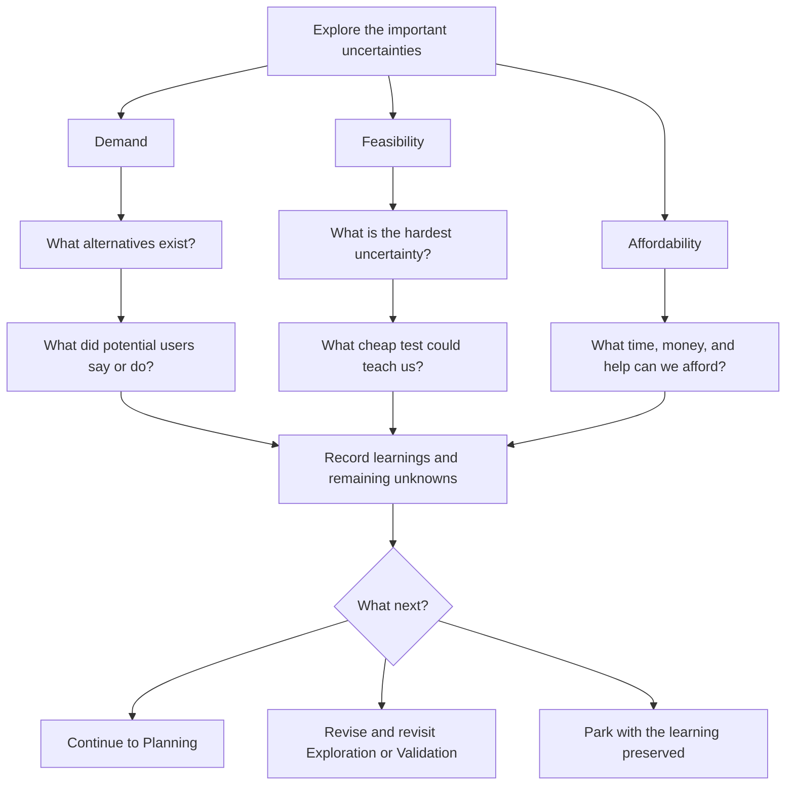

Example: “Ask five neighbors about their last tool purchase before building a booking system.” Record actual feedback separately from assumptions. “Nobody wanted this version” is useful evidence.

### 4. Planning — What's our first useful version?

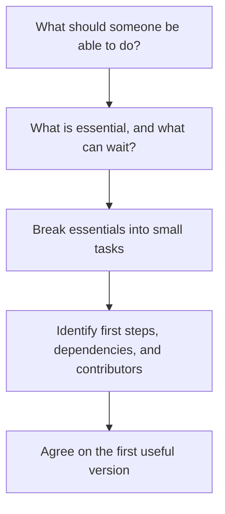

Example: “One neighbor can request one tool and receive a reply. Payments can wait.” A contributor is a willing person, not an automatic assignment.

### 5. Building — How do we make it happen?

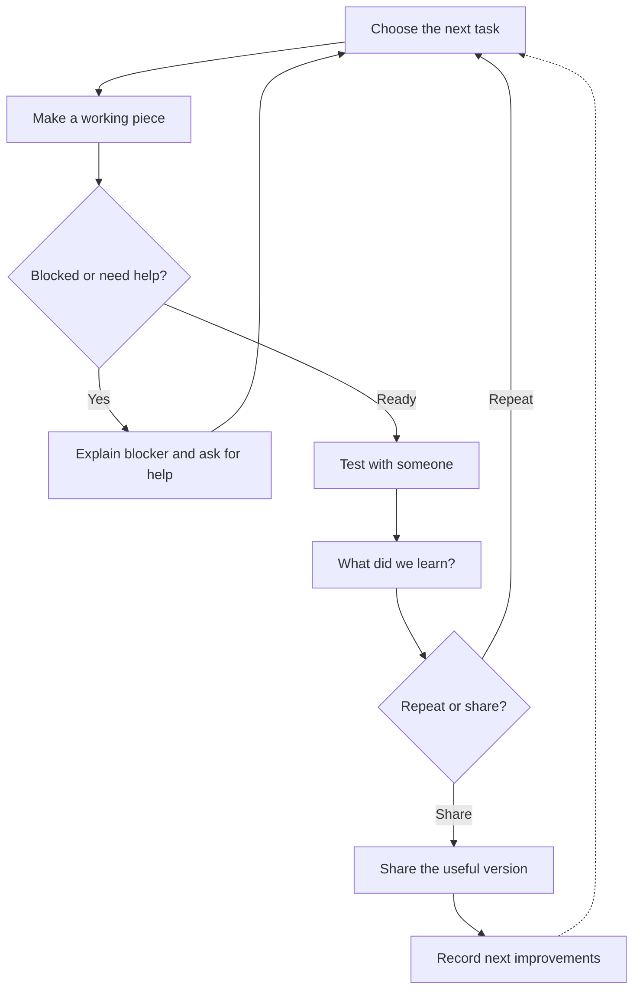

Example: “Try the request form with a neighbor and watch where they hesitate.” Testing can reveal a need to revisit earlier stages.

## Creative/fun overview

Keep this version for now. There is no requirement for profit, market demand, or commercial validation.

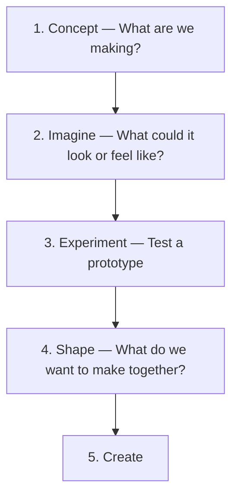

### 1. Concept — What are we making?

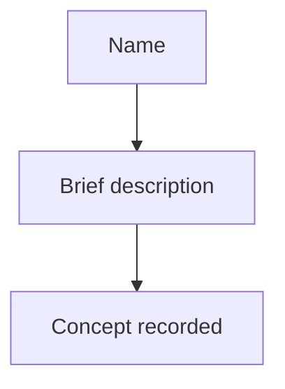

Example: “Audio production project made with friends.”

### 2. Imagine — What could it look or feel like?

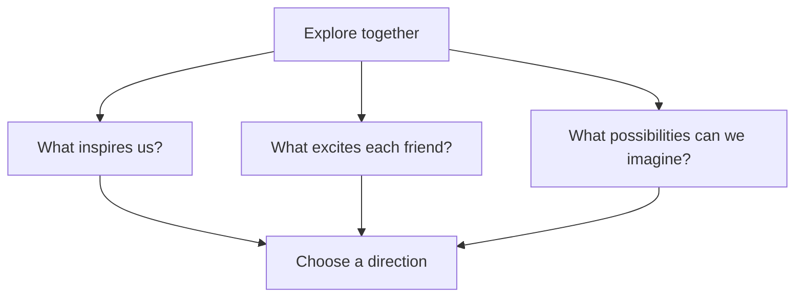

Example: “Warm voices, silly sea monsters, and homemade sound effects.” Different friends can want different things; keep those perspectives visible.

### 3. Experiment — Test a prototype

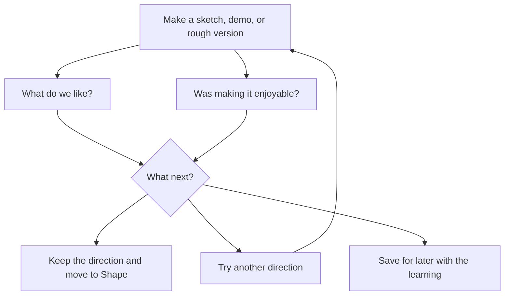

Example: “Record a one-minute scene on our phones.” Enjoyment is evidence worth recording, not a productivity score.

### 4. Shape — What do we want to make together?

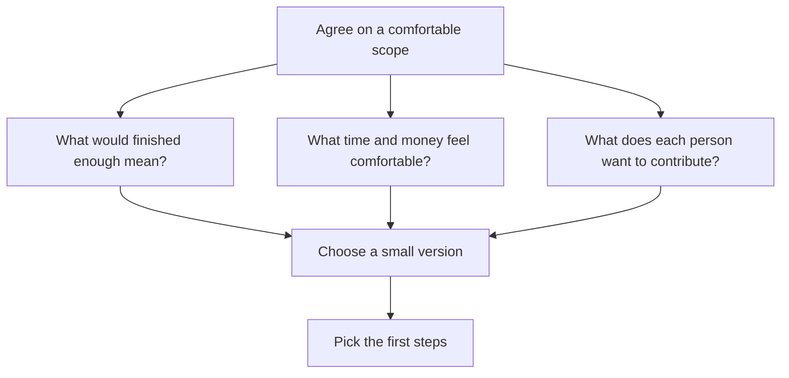

Example: “A five-minute episode, two evenings, no special purchases; each person chooses a part.”

### 5. Create

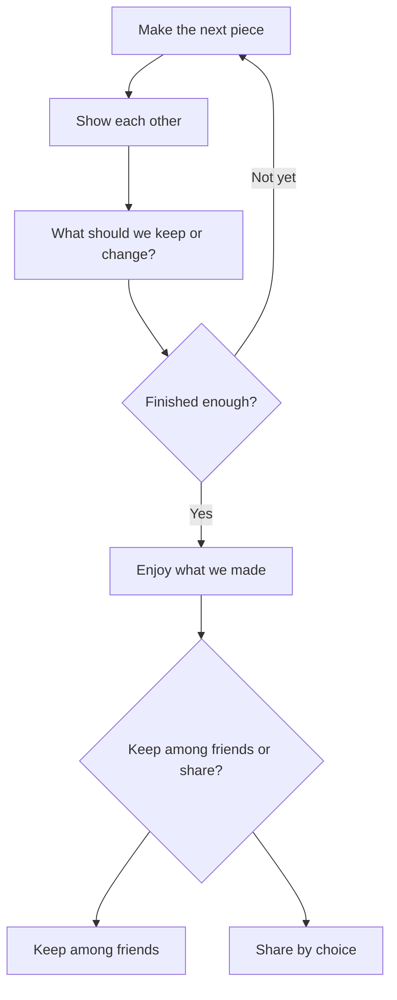

Example: “Listen together before deciding whether anyone else needs to hear it.” Finishing privately is a full, valid outcome.
